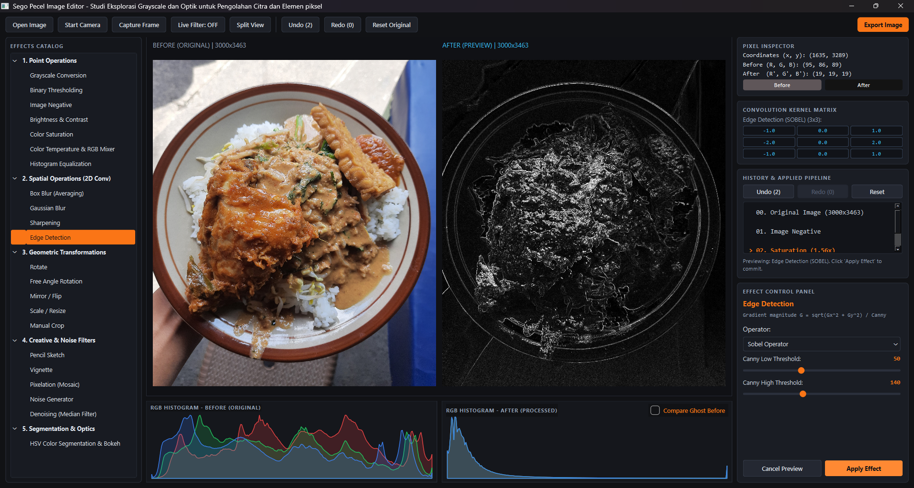
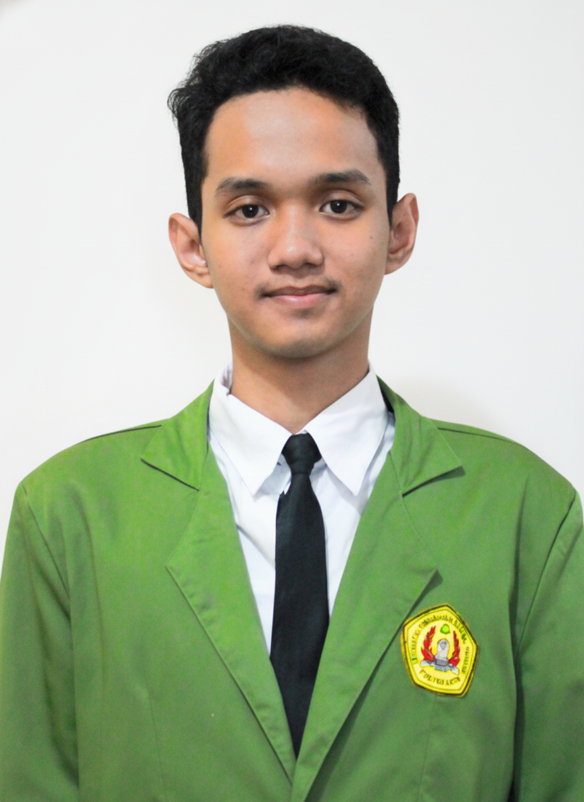
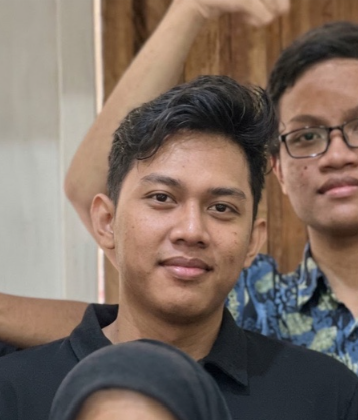

# Sego Pecel Image Editor

**Studi Eksplorasi Grayscale dan Optik untuk Pengolahan Citra dan Elemen piksel**

Sego Pecel Image Editor adalah aplikasi pengolahan citra digital berbasis desktop yang dibangun menggunakan **Python**, **PyQt6**, dan **NumPy**. Seluruh operasi manipulasi piksel, konvolusi spasial 2D, transformasi geometri, hingga segmentasi ruang warna diimplementasikan secara matematis menggunakan operasi matriks array NumPy tanpa bergantung pada fungsi filter instan bawaan pustaka pengolahan citra. Pustaka OpenCV (`cv2`) hanya digunakan untuk membaca/menyimpan berkas citra dan mengambil frame mentah dari kamera.

> Proyek ini dikerjakan sebagai tugas proyek mata kuliah **Pengolahan Citra** yang diampu oleh **Bapak Bambang Yuwono, S.T., M.T.**

---

## Fitur Utama

- **Layar Pembuka & Kartu Identitas Tim**: Menampilkan judul aplikasi bergaya tipografi klasik beserta kartu profil dan NIM seluruh anggota kelompok.
- **Dual Monitor & Split View**: Membandingkan citra asli (*Before*) dan citra hasil olahan (*After*) secara berdampingan maupun melalui mode *Split View* interaktif.
- **Alur Pengeditan Bertahap (*Staged Preview & Commit*)**:
  1. Pilih operasi dari **Effects Catalog** di panel kiri.
  2. Atur parameter intensitas, sudut, atau ukuran kernel pada **Effect Control Panel** di panel kanan sambil melihat pratinjau langsung (*Live Preview*).
  3. Klik **Apply Effect** untuk menyimpan perubahan ke dalam riwayat, atau **Cancel Preview** untuk membatalkan.
- **History & Applied Pipeline Log**: Mencatat seluruh urutan efek yang telah diterapkan (hingga 20 langkah) lengkap dengan fitur **Undo** (`Ctrl+Z`), **Redo** (`Ctrl+Y`), dan **Reset Original**.
- **Histogram RGB Sinkron & Ghost Overlay**: Menampilkan distribusi intensitas kanal Merah, Hijau, dan Biru untuk citra *Before* dan *After*, dilengkapi opsi **Compare Ghost Before** untuk membandingkan pergeseran kurva distribusi secara langsung.
- **Real-Time Pixel Inspector**: Menampilkan koordinat piksel `(x, y)`, nilai intensitas `(R, G, B)` asli vs `(R', G', B')` hasil olahan, serta pratinjau warna saat kursor diarahkan ke kanvas.
- **Convolution Kernel Matrix Viewer**: Menampilkan bobot matriks kernel `3x3` maupun `5x5` secara otomatis setiap kali operasi konvolusi spasial dipilih.
- **Live Camera Processing**: Mendukung pratinjau filter secara langsung pada umpan webcam (*Live Filter: ON/OFF*) lengkap dengan indikator performa **FPS (Manual NumPy)** dan fitur **Capture Frame** untuk diedit lebih lanjut.

---

## Katalog Algoritma (Implementasi Manual NumPy)

| Kategori | Fitur | Metode / Formulasi Matematis |
| :--- | :--- | :--- |
| **1. Point Operations** | Grayscale Conversion | Luminosity ($0.299R + 0.587G + 0.114B$) & Average ($(R+G+B)/3$) |
| | Binary Thresholding | $g(x,y) = 255$ jika $f(x,y) \ge T$, selain itu $0$ |
| | Image Negative | $g(x,y) = 255 - f(x,y)$ |
| | Brightness & Contrast | $\text{clip}(\alpha \cdot (f(x,y) - 128) + 128 + \beta, 0, 255)$ |
| | Color Saturation | Interpolasi luminansi $C' = \text{clip}(L + S \cdot (C - L), 0, 255)$ |
| | Color Temperature & RGB Mixer | Pergeseran temperatur hangat/dingin dan pengali kanal $(w_R, w_G, w_B)$ |
| | Histogram Equalization | Pemetaan ulang intensitas berbasis PDF & CDF kumulatif per kanal |
| **2. Spatial Operations** | Box Blur | Konvolusi 2D manual dengan kernel rata-rata $3\times3$ ($1/9$) |
| | Gaussian Blur | Konvolusi 2D manual menggunakan kernel Gaussian $3\times3$ ($1/16$) dan $5\times5$ ($1/273$) |
| | Sharpening | Konvolusi 2D manual dengan kernel *high-boost* pusat tinggi |
| | Edge Detection | Gradien Sobel, Prewitt, turunan kedua Laplacian, dan Canny 4-tahap |
| **3. Geometric Transforms** | Rotate | Transposisi matriks dan pembalikan sumbu ($90^\circ, 180^\circ, 270^\circ$) |
| | Free Angle Rotation | Matriks rotasi invers dengan interpolasi bilinear manual |
| | Mirror / Flip | Pembalikan indeks kolom (Horizontal) dan baris (Vertical) |
| | Scale / Resize | Pemetaan rasio koordinat dengan *Bilinear* & *Nearest-Neighbor Interpolation* |
| | Manual Crop | Pemotongan array interaktif dengan area luar teredup (*dimmed overlay*) |
| **4. Creative & Noise** | Pencil Sketch | Kombinasi grayscale, negatif ter-blur, dan rumus *Color Dodge* manual |
| | Vignette | Masker jatuh cahaya radial berbasis jarak Euclidean dari pusat citra |
| | Pixelation (Mosaic) | Perhitungan rata-rata warna per blok ukuran $k \times k$ piksel |
| | Noise Generator | Pembangkit derau acak *Salt & Pepper* dan distribusi normal *Gaussian* |
| | Denoising (Median Filter) | Filter spasial non-linear nilai tengah pada jendela $3\times3$ dan $5\times5$ |
| **5. Segmentation & Optics** | HSV Color Segmentation & Bokeh | Konversi manual RGB ke HSV, pembentukan masker *Hue*, dan blur latar belakang |

---

## Struktur Direktori Proyek

```text
sego_pecel_image_editor/
├── main.py                              # Titik masuk utama aplikasi
├── requirements.txt                     # Daftar dependensi Python
├── assets/                              # Foto profil anggota kelompok & aset font
│   ├── anggota_1.png
│   ├── anggota_2.png
│   ├── anggota_3.png
│   └── anggota_4.png
├── core/                                # Mesin inti aplikasi
│   ├── camera_thread.py                 # QThread webcam & penghitung FPS real-time
│   ├── convolution_engine.py            # Mesin konvolusi 2D sliding-window NumPy
│   └── history_manager.py               # Manajemen stack Undo / Redo & log pipeline
├── algorithms/                          # Modul rumus pengolahan citra terpisah
│   ├── point_grayscale.py
│   ├── point_threshold.py
│   ├── point_negative.py
│   ├── point_brightness_contrast.py
│   ├── point_saturation.py
│   ├── point_color_balance.py
│   ├── point_equalization.py
│   ├── spatial_box_blur.py
│   ├── spatial_gaussian_blur.py
│   ├── spatial_sharpen.py
│   ├── spatial_edge_detection.py
│   ├── geo_rotate_flip.py
│   ├── geo_resize_crop.py
│   ├── fx_sketch_vignette.py
│   ├── fx_pixelate.py
│   ├── fx_noise_denoise.py
│   └── fx_hsv_bokeh.py
└── ui/                                  # Komponen antarmuka pengguna PyQt6
    ├── welcome_screen.py                # Layar pembuka profil tim
    ├── main_window.py                   # Jendela utama & katalog efek
    ├── canvas_widget.py                 # Kanvas Before-After, Split View & Crop
    ├── histogram_widget.py              # Grafik histogram RGB & Ghost Overlay
    └── inspector_panel.py               # Pixel Inspector, Kernel Matrix, History & Control Panel
```
---

## Instalasi & Cara Menjalankan
### 1. Prasyarat
- Python **3.10** atau versi lebih baru
- Webcam (opsional, untuk fitur *Live Camera*)

### 2. Langkah Instalasi
Clone repositori ini lalu pasang pustaka yang dibutuhkan:

```bash
git clone https://github.com/kelfinofarelino/sego-pecel-image-editor.git
cd sego-pecel-image-editor
pip install -r requirements.txt
```

### 3. Menjalankan Aplikasi
```bash
python main.py
```

---

## Panduan Penggunaan

1. **Masuk ke Ruang Kerja**: Pada layar pembuka, klik tombol **MULAI** untuk membuka jendela editor utama.
2. **Memuat Sumber Citra**:
   - Klik **Open Image** pada bilah atas untuk memilih berkas gambar (`.png`, `.jpg`, `.jpeg`, `.bmp`).
   - Atau klik **Start Camera** untuk mengaktifkan webcam, aktifkan **Live Filter: ON** untuk menguji filter secara langsung, dan tekan **Capture Frame** untuk menangkap gambar ke ruang kerja.
3. **Menerapkan Efek Secara Berantai**:
   - Pilih salah satu efek pada daftar **Effects Catalog** di sisi kiri.
   - Sesuaikan parameter pada **Effect Control Panel** di kanan bawah; hasil sementara langsung terlihat pada monitor **AFTER (PREVIEW)**.
   - Klik **Apply Effect** untuk mengunci perubahan ke riwayat. Anda dapat langsung memilih efek berikutnya untuk menumpuk pemrosesan secara berurutan.
4. **Inspeksi & Riwayat**:
   - Arahkan kursor pada gambar *After* untuk memeriksa perubahan nilai piksel pada **Pixel Inspector**.
   - Centang **Compare Ghost Before** di bawah histogram *After* untuk melihat perbandingan distribusi warna sebelum dan sesudah diedit.
   - Gunakan tombol **Undo** (`Ctrl+Z`), **Redo** (`Ctrl+Y`), atau **Reset Original** untuk menavigasi riwayat pengeditan.
5. **Menyimpan Hasil**: Klik **Export Image** di pojok kanan atas untuk menyimpan hasil akhir dalam format PNG atau JPG.

## Tim Pengembang

<table>
  <tr>
    <td align="center" width="25%">
      <br />
      <strong>Muhammad Farelino Kelfin Ramadhani</strong><br />
      <sub>NIM: 123240205</sub>
    </td>
    <td align="center" width="25%">
      <br />
      <strong>Nama Anggota 2</strong><br />
      <sub>NIM: 123240002</sub>
    </td>
    <td align="center" width="25%">
      <br />
      <strong>Nama Anggota 3</strong><br />
      <sub>NIM: 123240003</sub>
    </td>
    <td align="center" width="25%">
      <br />
      <strong>Nama Anggota 4</strong><br />
      <sub>NIM: 123240004</sub>
    </td>
  </tr>
</table>